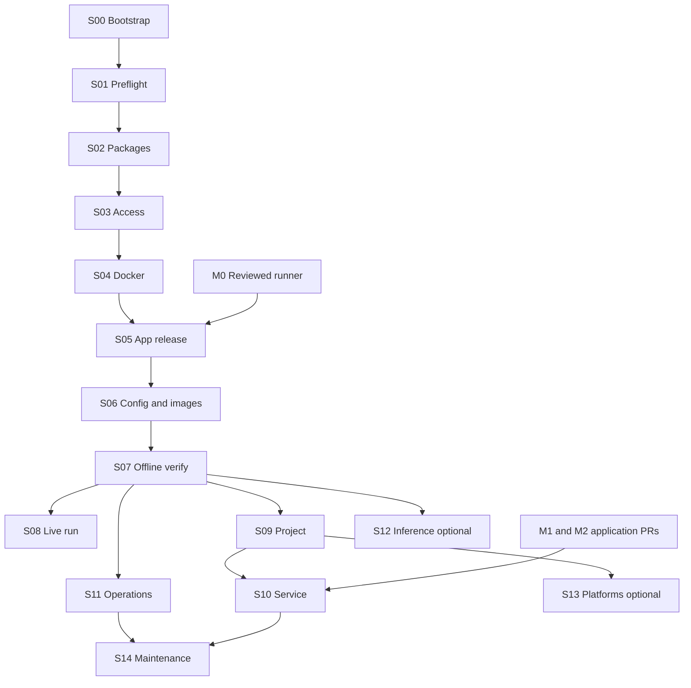

# План полуавтоматического развёртывания

Версия 1.0.0. **15 этапов S00–S14**, из них S12/S13 optional, S10 зависит от ещё не реализованного продукта, S14 — lifecycle. Интерфейсы: [CONTRACT.md](CONTRACT.md).

## Минимальный путь

Чистый VPS → вручную SSH-ключ/консоль/обычный sudo-user → S00–S07 → `runner_ready_offline` → отдельно S08 → один подтверждённый `needs_review` на toy. Это supervised Agent Runner, не unattended factory и не автоматический bugfix publisher. S09 добавляет движок/ручную доску и baseline; S11 — сопровождаемость. SQLite, App, service, Qwen и три платформы не входят в MVP.

До S05 существует внешний development blocker M0: reviewed package учебного runner. P06 только разворачивает этот package, не пишет orchestrator. При отсутствии M0 installer доходит до Docker/config planning и печатает `blocked: application_release_missing`.

Advanced path: S09 → application PR0–9/11 → S10, S11 restore/reboot/security drills → explicit unattended admission. Hybrid: Q0–Q5 из PR13 → PR14 → PR15/16/17 → S12 integration. S13 после PR12, когда продукту нужны платформы. В графе ребро S10→S14 относится только к service profile; supervised update не требует S10.

## Контракты этапов

### S00. Bootstrap и доверенный setup release

- Тип: **B**. Профиль: supervised/service. Зависимости: **—**.
- Цель: bootstrap и доверенный setup release с независимым подтверждением результата.
- Предусловия и вход: Архив релиза, checksum из доверенного канала, обычный sudo-user, Ubuntu 24.04 amd64.
- Изменения ресурсов: Минимальные ca-certificates/curl/xz-utils/gnupg; Node в user prefix; CLI launcher.
- Ручные действия: Доверие к release и минимальный apt; при root создать/проверить обычного пользователя до bootstrap.
- Выход: Node exact version, CLI --version, bootstrap-receipt.json.
- Проверки и критерий успеха: Сверить подпись/пины, UID, binary arch, CLI старт без shell profile.
- Ошибки: Corrupt archive/signature → abort9; apt partial → manual dpkg audit; network → bounded download retry.
- Повтор / recovery / предел rollback: Повтор проверяет hash и Node, staging очищается только по receipt; system packages не удалять.
- Команда: `factory-setup plan --config ~/.config/agent-factory/setup.json --stage S00`; затем `apply --config … --plan …`. S08 live и lifecycle команды имеют специальные verb из C02; plan этапа не запускает их. **Все команды planned CLI.**

### S01. Preflight и plan

- Тип: **A**. Профиль: supervised/service. Зависимости: **S00**.
- Цель: preflight и plan с независимым подтверждением результата.
- Предусловия и вход: setup.json, versions.lock, disk/RAM, systemd/cgroups, Docker discovery, host identity.
- Изменения ресурсов: Только planned report и setup-state после init; probes read-only.
- Ручные действия: Ресурсные предупреждения и неизвестная виртуализация требуют выбора другого host, не обхода.
- Выход: plan.json с hash, observation.json.
- Проверки и критерий успеха: 2 CPU/4 GiB/20 GiB free для toy; рекомендуемые 4CPU/8GiB/80GiB disk для engine; image-size estimate +20% и минимум15% free после установки; это проектные пороги.
- Ошибки: OS/arch/root/insufficient space →3; неизвестная схема→2; cgroup/overlay недоступны→5.
- Повтор / recovery / предел rollback: Повтор всегда observe; недостаток диска не исправлять prune или auto scale.
- Команда: `factory-setup plan --config ~/.config/agent-factory/setup.json --stage S01`; затем `apply --config … --plan …`. S08 live и lifecycle команды имеют специальные verb из C02; plan этапа не запускает их. **Все команды planned CLI.**

### S02. Системные зависимости

- Тип: **B**. Профиль: supervised/service. Зависимости: **S01**.
- Цель: системные зависимости с независимым подтверждением результата.
- Предусловия и вход: Одобренный plan, apt metadata, sudo; git,curl,CA,build-essential при build,tmux,ufw,sqlite3 только service.
- Изменения ресурсов: Пакеты из Ubuntu; фиксированные Docker/Tailscale ставят отдельные stages.
- Ручные действия: Точный список apt изменений; kernel/full-upgrade/reboot вручную отдельным maintenance.
- Выход: system-packages receipt; restart-required/reboot-required status.
- Проверки и критерий успеха: dpkg status, versions, git --version; CA и DNS probes; отсутствие незавершённой dpkg транзакции.
- Ошибки: apt lock120s→4; unsigned repo→9; unavailable package→5; service error→6.
- Повтор / recovery / предел rollback: После crash dpkg --audit; owner выполняет dpkg --configure -a при необходимости; не удалять чужие пакеты.
- Команда: `factory-setup plan --config ~/.config/agent-factory/setup.json --stage S02`; затем `apply --config … --plan …`. S08 live и lifecycle команды имеют специальные verb из C02; plan этапа не запускает их. **Все команды planned CLI.**

### S03. Безопасный SSH и Tailscale cutover

- Тип: **B**. Профиль: supervised/service. Зависимости: **S02**.
- Цель: безопасный ssh и tailscale cutover с независимым подтверждением результата.
- Предусловия и вход: Консоль провайдера, текущие SSH параметры и адрес/порт, ключ пользователя, Tailscale exact apt pin.
- Изменения ресурсов: Tailscale package; отдельный sshd drop-in; целевые UFW правила; rollback timer.
- Ручные действия: Device login, ACL/MFA, SSH со второго терминала и телефона; cloud firewall; подтверждение cutover.
- Выход: access evidence, резерв прежних правил, cutover receipt без device code.
- Проверки и критерий успеха: sshd -t и -T -C; новый вход и sudo; external IPv4/IPv6 scan; Tailscale policy; rollback timer активен до ack.
- Ошибки: Нет console или второй сессии→4; parser/Match conflict→8; auth expired→4; cutover потерян→timer rollback.
- Повтор / recovery / предел rollback: Повтор не дублирует правила. Snapshot только собственных изменений; timed rollback10min сохраняет исходный SSH доступ и отменяется после независимой проверки.
- Команда: `factory-setup plan --config ~/.config/agent-factory/setup.json --stage S03`; затем `apply --config … --plan …`. S08 live и lifecycle команды имеют специальные verb из C02; plan этапа не запускает их. **Все команды planned CLI.**

### S04. Docker host

- Тип: **B**. Профиль: supervised/service. Зависимости: **S02,S03**.
- Цель: docker host с независимым подтверждением результата.
- Предусловия и вход: Official signed apt repo, exact package set; approved docker group; iptables backend.
- Изменения ресурсов: Docker packages, daemon log options, group membership, local socket.
- Ручные действия: Группа docker ≈ root; relogin; restart gate при existing daemon.
- Выход: docker receipt + network/security observation.
- Проверки и критерий успеха: Client/server compatibility; actual cgroup memory/pids/CPU constraints; закреплённый hello fixture; нет TCP Docker API/public bindings; inspect mounts.
- Ошибки: docker.io/containerd conflict→8 без uninstall; bad config→restore managed diff; daemon fail→6; group stale→4.
- Повтор / recovery / предел rollback: Adopt existing compatible daemon после inspect; не restart при чужих active containers; cleanup только setup fixture labels.
- Команда: `factory-setup plan --config ~/.config/agent-factory/setup.json --stage S04`; затем `apply --config … --plan …`. S08 live и lifecycle команды имеют специальные verb из C02; plan этапа не запускает их. **Все команды planned CLI.**

### S05. Доверенный application release

- Тип: **B**. Профиль: supervised/service. Зависимости: **S04**.
- Цель: доверенный application release с независимым подтверждением результата.
- Предусловия и вход: Private GitHub factory repo; owner-exported release archive или read-only deploy key на host; M0 manifest.
- Изменения ресурсов: Versioned staging и application checkout; npm ci для доверенного package lock; hooks disabled.
- Ручные действия: Review artifact/source commit/Dockerfile; приватный repo создаёт владелец; read-only access если clone.
- Выход: Validated deployment-manifest, app source receipt, complete release dir.
- Проверки и критерий успеха: Hash каждого файла, clean tree, remote allowlist, commit; A1/A2/A3 или capability runner-readonly; no symlinks traversal.
- Ошибки: Отсутствует M0→5; private auth→4; dirty checkout→8; missing commit→5; unsafe archive→9.
- Повтор / recovery / предел rollback: Не git reset/clean; staged new release, old untouched. Existing unexpected path→blocked; менять app source установщиком запрещено.
- Команда: `factory-setup plan --config ~/.config/agent-factory/setup.json --stage S05`; затем `apply --config … --plan …`. S08 live и lifecycle команды имеют специальные verb из C02; plan этапа не запускает их. **Все команды planned CLI.**

### S06. Конфигурация, схемы, образы

- Тип: **B**. Профиль: supervised/service. Зависимости: **S05**.
- Цель: конфигурация, схемы, образы с независимым подтверждением результата.
- Предусловия и вход: Reviewed defaults/policy, pinned Codex/base digest, M0 schemas, build context allowlist.
- Изменения ресурсов: auth/state dirs; policy-level1.json; trusted agent image; toy fixture; generated effective configs.
- Ручные действия: Build trust gate и diff для существующего файла; default timeout300/daily3.
- Выход: Config hashes, local image ID/digest, schemas, fixture Git SHA.
- Проверки и критерий успеха: Ajv compile, trusted generator only; codex --version/help без auth; dockerignore исключает secrets; output UID соответствует owner.
- Ошибки: Unknown CLI flags/version→5; image disk full→6; manually edited config→8; symlink/permissions→9.
- Повтор / recovery / предел rollback: Create-if-absent, compare hashes; image reusable if exact digest+arch; unowned tags не удалять; policy limits не повышать.
- Команда: `factory-setup plan --config ~/.config/agent-factory/setup.json --stage S06`; затем `apply --config … --plan …`. S08 live и lifecycle команды имеют специальные verb из C02; plan этапа не запускает их. **Все команды planned CLI.**

### S07. Offline runner verification

- Тип: **A**. Профиль: supervised/service. Зависимости: **S06**.
- Цель: offline runner verification с независимым подтверждением результата.
- Предусловия и вход: M0 packaged verify + fake provider; Docker smoke image; no credentials.
- Изменения ресурсов: Только isolated fixture outputs и bounded temporary containers.
- Ручные действия: Нет, пока проверяются synthetic data без модели.
- Выход: offline-verification.json; состояние runner_ready_offline.
- Проверки и критерий успеха: A3 negative fixtures + real no-secret Docker mount/UID/limits/stop probes; fake run validates task/SHA; cleanup подтверждён.
- Ошибки: Mock pass/real Docker fail→6; residual container→8; no runner capability→5.
- Повтор / recovery / предел rollback: Повтор не расходует AI budget; cleanup receipts; fake state отдельно от production day count.
- Команда: `factory-setup plan --config ~/.config/agent-factory/setup.json --stage S07`; затем `apply --config … --plan …`. S08 live и lifecycle команды имеют специальные verb из C02; plan этапа не запускает их. **Все команды planned CLI.**

### S08. Авторизация и первый live Scout

- Тип: **B**. Профиль: supervised/service. Зависимости: **S07**.
- Цель: авторизация и первый live scout с независимым подтверждением результата.
- Предусловия и вход: Owner subscription; auth dir; image; explicitly enabled device auth; supervised risk acceptance.
- Изменения ресурсов: Credential только auth; runner run record и output.
- Ручные действия: OAuth в браузере; accepted credential exposure; отдельный live-run gate.
- Выход: auth presence status, live-run ID/hash, needs_review, unchanged toy SHA.
- Проверки и критерий успеха: login status не доказывает quota; один run300s, no retry, valid JSON/task/SHA; source clean; container absent.
- Ошибки: Expired login→4; quota/unknown failure→5/6 без API fallback; timeout→blocked; lost request→manual, не replay.
- Повтор / recovery / предел rollback: auth status повторяем; live smoke НЕ автоматически идемпотентен: новый запуск только новым gate; completed run не повторять на resume.
- Команда: `factory-setup plan --config ~/.config/agent-factory/setup.json --stage S08`; затем `apply --config … --plan …`. S08 live и lifecycle команды имеют специальные verb из C02; plan этапа не запускает их. **Все команды planned CLI.**

### S09. Проект, доска и baseline

- Тип: **B**. Профиль: supervised/service. Зависимости: **S07**.
- Цель: проект, доска и baseline с независимым подтверждением результата.
- Предусловия и вход: Собственный target repository allowlist, точный candidate SHA, manual GitHub board, выбранный baseline.
- Изменения ресурсов: Отдельный clean checkout; project config proposal; workflow/Dependabot drafts, manual baseline note.
- Ручные действия: Владелец создаёт Project/fields/issues, merge workflow PR, проверяет billing/notifications; первый engine Scout после S08 отдельным run.
- Выход: Target .nvmrc/lock/workflow metadata на SHA, baseline evidence либо unknown.
- Проверки и критерий успеха: Node target независимо от Node factory; no project code on host/auth worker; required guard exists exact SHA, no skipped-as-pass.
- Ошибки: Remote/auth failure→4/6; dirty copy→8; draft/path-ignore→unknown; missing adapter→5 только advanced checker.
- Повтор / recovery / предел rollback: Fetch без reset; новый detached checkout на другой SHA; installer не публикует PR и не dispatch без explicit separate gate.
- Команда: `factory-setup plan --config ~/.config/agent-factory/setup.json --stage S09`; затем `apply --config … --plan …`. S08 live и lifecycle команды имеют специальные verb из C02; plan этапа не запускает их. **Все команды planned CLI.**

### S10. Постоянная служба и migrations

- Тип: **D→B**. Профиль: service only. Зависимости: **S07,S09**.
- Цель: постоянная служба и migrations с независимым подтверждением результата.
- Предусловия и вход: M1 application PR0–4/commands; M2 PR8/9/11 для unattended; backup before migration; no active workers.
- Изменения ресурсов: /opt release/current, /var/lib data, SQLite migration через app command, systemd unit.
- Ручные действия: Перенос из supervised, DB migration, service enable; отдельно unattended admission.
- Выход: DB version/checks, unit, paused service health; capability evidence.
- Проверки и критерий успеха: Absolute Node; app honors paths; FK/integrity; recover before serve; reboot recovery; no new run пока PAUSED.
- Ошибки: Missing commands/security enforcement→5; DB busy→bounded wait then4; failed migration→rollback transaction; unit fail→paused old release.
- Повтор / recovery / предел rollback: user_version atomically; no down migration. Restore paired app+DB snapshot; unknown usage held; несовместимость старого кода с новой DB блокирует переключение.
- Команда: `factory-setup plan --config ~/.config/agent-factory/setup.json --stage S10`; затем `apply --config … --plan …`. S08 live и lifecycle команды имеют специальные verb из C02; plan этапа не запускает их. **Все команды planned CLI.**

### S11. Backup, health и emergency

- Тип: **B**. Профиль: supervised/service. Зависимости: **S07; S10 для DB/service**.
- Цель: backup, health и emergency с независимым подтверждением результата.
- Предусловия и вход: Managed resource inventory, local backup destination; service status API если существует.
- Изменения ресурсов: Level1 manifest/history backup без auth; service SQLite .backup; timers, own logs; optional health endpoint reference.
- Ручные действия: Внешняя копия на ПК и restore drill; phone stop; внешний health/ntfy opt-in.
- Выход: Backup manifest/hash/integrity; retention report; recovery runbook; emergency inventory.
- Проверки и критерий успеха: Backup restore в отдельный dir; latest known-good сохраняется; offsite receipt owner; cancel работает при lock; stop owned containers only.
- Ошибки: Disk/SQLite busy→6 без удаления последней копии; alert unavailable→degraded; Docker dead→owner console.
- Повтор / recovery / предел rollback: Backup create new ID; verify read-only; restore separate gate, no automatic unpause; таймер не даёт гарантий offsite backup.
- Команда: `factory-setup plan --config ~/.config/agent-factory/setup.json --stage S11`; затем `apply --config … --plan …`. S08 live и lifecycle команды имеют специальные verb из C02; plan этапа не запускает их. **Все команды planned CLI.**

### S12. Локальный inference

- Тип: **E (A/B/D)**. Профиль: optional. Зависимости: **S07; PR13 для probes; PR14–17 для integration**.
- Цель: локальный inference с независимым подтверждением результата.
- Предусловия и вход: Ollama exact digest, model full digest/size/license, RAM profile, approved download; external app capabilities.
- Изменения ресурсов: Owned volume/network internal, staged download container, pinned Compose, backend disabled by default.
- Ручные действия: Вес/размер/ресурсы; experimental benchmark отдельно; promotion только reviewed PR.
- Выход: API health, full model digest, resource measurements, optional stage report.
- Проверки и критерий успеха: No ports/host/auth/socket; no LAN/metadata/internet path; model ready and context; conformance prerequisite для routed use.
- Ошибки: OOM/model mismatch→optional_failed; cleanup owned download; cloud-only unaffected; absent runtime→integration blocked.
- Повтор / recovery / предел rollback: Один writer на model volume; serving stopped during pull; disable stops+backend disabled, weights retained. Delete weights отдельное решение, не disable.
- Команда: `factory-setup plan --config ~/.config/agent-factory/setup.json --stage S12`; затем `apply --config … --plan …`. S08 live и lifecycle команды имеют специальные verb из C02; plan этапа не запускает их. **Все команды planned CLI.**

### S13. Платформенные проверки

- Тип: **E (B/D)**. Профиль: optional. Зависимости: **S09; PR12 для интеграции**.
- Цель: платформенные проверки с независимым подтверждением результата.
- Предусловия и вход: Real reviewed browser_smoke adapter; trusted workflow SHA; Actions billing; runtime labels.
- Изменения ресурсов: Только generated workflow proposal/validation; optional integration records после ручного merge.
- Ручные действия: Owner merge workflow, permissions and one explicit test dispatch.
- Выход: Matrix/producer/candidate evidence; no-op profiles forbidden.
- Проверки и критерий успеха: Exact SHA + workflow/job identity + actual OS/arch; linux pass не Windows/macOS; inspect runner image revision.
- Ошибки: Missing PR12/browser_smoke→5; hosted unavailable→awaiting_checks; rate/auth→bounded GET/no POST replay.
- Повтор / recovery / предел rollback: Reconcile run identity after timeout; не включать все ОС default; workflow template не evidence.
- Команда: `factory-setup plan --config ~/.config/agent-factory/setup.json --stage S13`; затем `apply --config … --plan …`. S08 live и lifecycle команды имеют специальные verb из C02; plan этапа не запускает их. **Все команды planned CLI.**

### S14. Обновление и восстановление

- Тип: **B**. Профиль: supervised/service. Зависимости: **S07; S10/S11 для service**.
- Цель: обновление и восстановление с независимым подтверждением результата.
- Предусловия и вход: Новый reviewed release/lock, existing observation, verified backup; maintenance pause.
- Изменения ресурсов: Staged release; config proposal; explicit DB migration; current switch; update receipt.
- Ручные действия: Release trust, changed permissions/config, migration/restore; OS upgrade отдельное окно.
- Выход: Before/after hashes/versions, verification, paired recovery plan.
- Проверки и критерий успеха: Drain active jobs; fake smoke before activation; config/API/schema compatibility; restart paused.
- Ошибки: Crash during switch→compare symlink/receipt; bad post-check→old app only if DB compatible; partial rollback→8.
- Повтор / recovery / предел rollback: Не latest/git pull in-place; changed state schema backup+migration; no automatic live smoke/retry paid action; data retained.
- Команда: `factory-setup plan --config ~/.config/agent-factory/setup.json --stage S14`; затем `apply --config … --plan …`. S08 live и lifecycle команды имеют специальные verb из C02; plan этапа не запускает их. **Все команды planned CLI.**

## Ручные gates и запрет скрытого согласия

Покупка/тариф/доступ консоли и SSH private key остаются за владельцем. Создание приватного GitHub repository и первая публикация setup/application release выполняются на доверенном ПК; VPS получает reviewed archive по scp, поэтому GitHub token на MVP VPS не нужен. После auth остаётся принятие риска доступного worker model credential. SSH/firewall требуют независимой сессии и timed recovery, Docker group — отдельного root-equivalent gate. Не включать generic --yes.

Необходимые внешние решения: модель/подписка и billing, OAuth, tailnet membership/ACL/MFA, GitHub board/notifications и PR merge. Дальше вручную: credentials backup в password manager, offsite backup pull, restore drill, разрешение новых платных endpoint/ressources (installer их не создаёт), любые release/merge/major/snapshot changes. Отсутствие телефона не должно мешать CLI разработке, но phone access drill нужен для режима постоянной эксплуатации исходного guide.

## Что считается завершением

Отчёт содержит installed/verified/blocked/skipped по каждому выбранному stage, обязательные blockers, manual actions с конкретной командой/ссылкой, resource ownership, версии и age verification. `runner_ready_offline`, `runner_live_verified`, `service_paused_verified`, `unattended_admitted` — различные capabilities. Success install не означает success model, зеленый CI или принятый PR. Optional failure не переводит cloud-only в failed, но выдаёт exit10 если optional явно запрошен; skipped optional отражается без exit failure.

## Reboot посередине

После SSH: status --refresh → resume. Observe rechecks system, package DB, Docker identities, configs, application manifest. Старый installed checkpoint без результата проверки не позволяет следующий stage. Если crash был после docker create — найти container по installation/operation label, подтвердить принадлежность и удалить только его. После crash OAuth/live — проверить auth присутствие и run record; новый model call не делать. Service восстановить paused, app recover отвечает за lost/unknown_held. Resume не снимает factory PAUSED.
